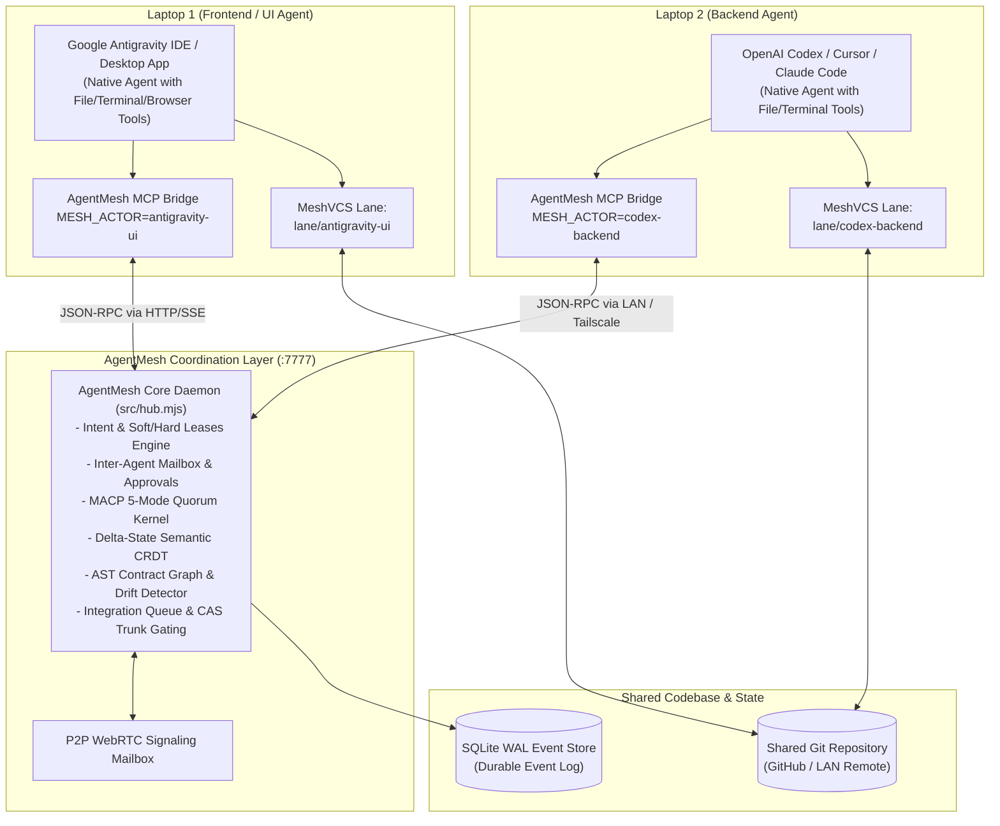
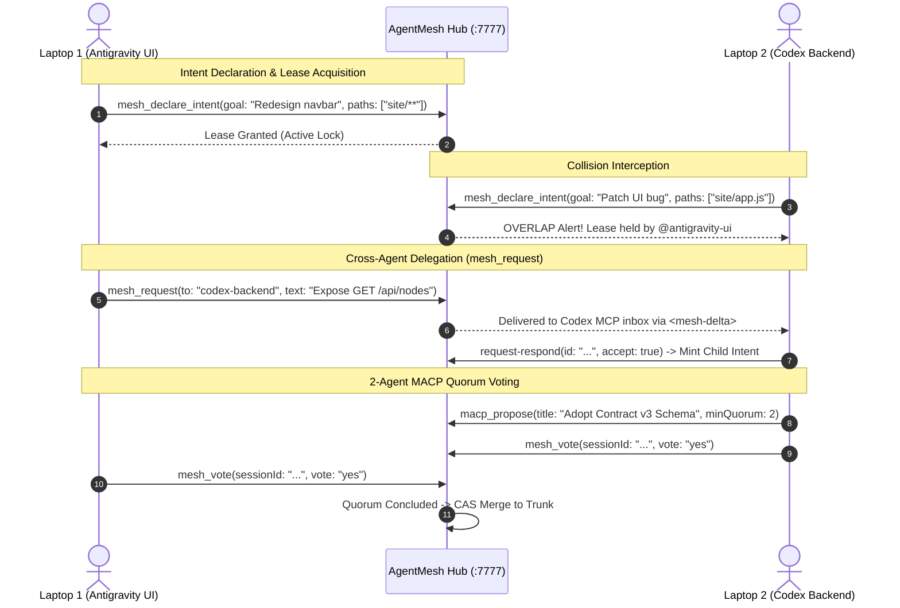

# AgentMesh — Production Multi-Harness AI Agent Coordination Mesh

[](https://github.com/harshalsp07/AgentMesh/actions)
[](https://hub.docker.com/r/harshalsp07/agentmesh)
[](https://harshalsp07.github.io/AgentMesh/)
[](https://modelcontextprotocol.io/)
[](https://a2a-protocol.org/)
[](LICENSE)

> 🗺️ **Where we're going:** [docs/PRODUCTION_PLAN.md](docs/PRODUCTION_PLAN.md) — the plan to make AgentMesh the default answer for AI-agent collaboration (protocol versioning, durable state, fenced leases, real contract graphs, multi-tenancy, outcome-based evals).
> 📚 **Research:** [docs/research/agent-protocols-landscape-2026.md](docs/research/agent-protocols-landscape-2026.md) — a primary-source survey of MCP, A2A, ACP, AG-UI, Claude Code agent teams, worktree orchestrators, evals and multi-agent failure taxonomies.
> 🔒 **Security:** [docs/SECURITY.md](docs/SECURITY.md) — the threat model, and exactly which controls are shipped vs planned.

**AgentMesh** enables multiple independent AI coding harnesses—such as **Google Antigravity** on Laptop 1 and **OpenAI Codex / Cursor / Claude Code** on Laptop 2—to safely collaborate on the **exact same repository in real time** without overwriting each other's work or breaking API contracts.

---

## ✅ What's shipped (v1.2)

| Phase | Feature | Entry points |
|---|---|---|
| P0 · TTFC | `mesh init <any-repo>` — agent config + rules in seconds, idempotent, never clobbers existing client configs | `bin/mesh init`, `mesh doctor --fix` |
| P1 · Conductor | Budgeted coordination agent with 6 roles (scout/dispatcher/referee/reviewer/shepherd/keeper); dry by default, live CLI ops-gated | `bin/mesh bot run --goal "…"`, `mesh_bot` MCP tool, `demo-bot.mjs` |
| P3 · Task board | Atomic claims, WIP limits (default 2), dependency chains; `task.*` events stream everywhere | `bin/mesh tasks …`, `/api/tasks`, `mesh_task_*` tools |
| P4 · Services & symbols | Port/service + shared-symbol leases in the intent engine: same-service re-declares block or warn with a real plan | `mesh_declare_intent(services, symbols)` |
| P5 · Fleet ops | Multi-repo tagging (`MESH_REPOS`), reliability CI incl. Windows matrix | `.github/workflows/ci.yml` |
| P6 · Trust & audit | Ed25519 tokens with instant revocation + rotation; Merkle-verified audit bundle export | `bin/mesh audit export`, `/api/audit` |
| Site | `landing.html`, `docs.html`, `playground.html` (real kernels in-browser), `blog.html`, `sitemap.xml`, `robots.txt`, `llms.txt`, PWA cache | `site/*` |

---

## 🌟 The Problem: Why Multi-Agent Coding Breaks Down

When developers run independent AI agents on the same codebase across multiple machines:
1. **Silent Overwrites & Race Conditions**: Agent A refactors frontend code while Agent B modifies backend endpoints, unknowingly breaking assumptions.
2. **Context Blindness**: Neither agent knows what the other is doing until `git push` fails with merge conflicts.
3. **No Consensus Protocol**: Breaking changes land on trunk without automated quorum or peer agent verification.

**AgentMesh solves this at the protocol layer.** Instead of acting as an artificial chatbot harness, AgentMesh is an **event-sourced coordination daemon** providing:
- **Intent-Before-Edit**: Agents declare target file scopes before modifying code, receiving sub-50ms collision alerts.
- **Copy-on-Write Lanes (MeshVCS)**: Agents work in isolated virtual lanes above Git; instant undo and rewind without rewriting history.
- **MACP 5-Mode Consensus Kernel**: RFC-grade decision, proposal negotiation, and quorum voting before landing shared schema updates.
- **Delta-State Semantic CRDT**: Strong Eventual Consistency (SEC) across AST symbols and contracts via Lamport vector clocks.
- **Universal Model Context Protocol (MCP)**: Native stdio JSON-RPC 2.0 bridge supported out-of-the-box by Antigravity, Cursor, Claude Code, and Windsurf.

---

## 🏗 System Architecture



---

## ⚡ Quickstart: Connect 2 Laptops in Under 2 Minutes

### Step 0: Install the mesh into ANY existing repo (TTFC)
Any repo, any laptop, one command — writes `.agents/mcp_config.json` + rules, detects the
IDEs you already use, and never clobbers their configs:
```bash
npx @harshalsp/agentmesh init          # or: node bin/mesh init <repo-path>
# → actor derived from package name, connectivity via `mesh doctor`, join via `mesh-join`
```

### Step 1: Start Hub on Laptop 1 (Host)
On Laptop 1, clone the repository and start the Hub daemon on all network interfaces:
```bash
git clone https://github.com/harshalsp07/AgentMesh.git
cd AgentMesh
npm test               # Verify 109 tests pass

# Create the keypair -> capability auth is enforced from here on.
node bin/mesh up
node bin/mesh token antigravity-ui   # per-actor capability (8 h TTL)

# Start Hub listening for LAN connections
MESH_HOST=0.0.0.0 node src/hub.mjs
```
*Note your Laptop 1 LAN IP address (e.g. `192.168.1.50`).*

> 🔒 **A non-loopback bind without auth refuses to start** (exit 78) — a LAN-reachable hub must
> never be world-writable. `mesh up` creates the keys; `MESH_INSECURE=1` is the explicit opt-out for
> a trusted network. See [docs/SECURITY.md](docs/SECURITY.md).

### Step 2: Configure Google Antigravity on Laptop 1
Google Antigravity automatically detects [`.agents/mcp_config.json`](.agents/mcp_config.json) located in this workspace:
```json
{
  "mcpServers": {
    "agentmesh": {
      "command": "node",
      "args": ["src/bridge.mjs"],
      "env": {
        "MESH_ACTOR": "antigravity-ui",
        "MESH_HUB": "http://localhost:7777"
      }
    }
  }
}
```
Antigravity automatically reads [`.agents/rules/agentmesh.md`](.agents/rules/agentmesh.md) and [`AGENTS.md`](AGENTS.md) and begins coordinating as `antigravity-ui`.

### Step 3: Connect Laptop 2 (Codex / Cursor / Claude Code)
On Laptop 2, clone the repository and execute the zero-config join script:
```bash
git clone https://github.com/harshalsp07/AgentMesh.git
cd AgentMesh

# Mint a token for this machine on Laptop 1 first, then:
./bin/mesh-join http://<LAPTOP_1_IP>:7777 codex-backend --token <capability-token>
# Example: ./bin/mesh-join http://192.168.1.50:7777 codex-backend --token eyJ...
```

**That's it!** Both agents are now linked into the mesh. Open **`http://<LAPTOP_1_IP>:7777`** in any browser to observe the live topology canvas.

---

## 🔄 Multi-Agent Lifecycle & Cross-Harness Workflow



---

## 🛠 Model Context Protocol (MCP) Tools

Every connected agent receives these tools natively inside their IDE chat context:

| Tool Name | Parameters | Description |
|---|---|---|
| `mesh_declare_intent` | `goal`, `paths`, `effect`, `contracts`, `services`, `symbols` | Declare intended file mutations **before** writing code. Returns collision and breaking-change warnings; `services` (e.g. `port:3000`) create real soft/hard leases, `symbols` flag shared function ids. |
| `mesh_release` | `id` | Free a declared intent and release file locks once changes are committed or abandoned. |
| `mesh_status` | *(none)* | Inspect your current factsheet: active scopes, contracts used, and active neighbors. |
| `mesh_inbox` | *(none)* | Drain unread peer notifications, contract updates, and inter-agent requests. |
| `mesh_request` | `to`, `text`, `ref` | Delegate a task or schema requirement to a peer agent across laptops (e.g., `@codex-backend`). First request between two actors seeds the TTFC metric. |
| `mesh_task_create` | `title`, `paths`, `deps`, `note` | Create a task on the shared board — event-sourced, canvas-visible. |
| `mesh_task_list` | `status?`, `owner?` | Read the board (supports `pending`, `in-progress`, `blocked`, `done` filters). |
| `mesh_task_claim` | `id` | **Atomic** claim: first actor wins, the loser gets a 409-style blocker (never a double-assign). |
| `mesh_task_set` | `id`, `status`, `note?` | Move a task you own (`done` requires deps done; `pending` releases the claim). |
| `mesh_bot` | `goal`, `dry?`, `tasks?` | Run the **Conductor** (dry default): scout → dispatcher → referee → report under a coin budget. |
| `mesh_memory_get` / `mesh_memory_set` | `key?` / `text` | Repo memory kept by the Conductor's keeper role — plain markdown at `<mesh>/memory.md`. |
| `mesh_vote` | `id`, `vote`, `weight`, `rationale` | Cast a binding vote in an active MACP decision or quorum session before trunk integration. |
| `mesh_propose_contract` | `title`, `mode`, `participants`, `spec` | Open an RFC-grade bounded coordination session for architectural updates. |
| `mesh_crdt_set` | `key`, `value` | Mutate a shared AST symbol, config key, or contract node in the Delta-State CRDT. |
| `mesh_roster` | *(none)* | View all active agents, their assigned lanes, and current heartbeats. |
| `mesh_pin` | `node`, `text` | Drop an AST spatial pin on a file or contract to alert only the relevant scope owners. |
| `mesh_board_post` | `text`, `color`, `codeRef` | Post a sticky note to the shared visual whiteboard linked to specific code references. |

---

## 🧱 The Five Architectural Pillars

### 1. Intent Before Edit & AST Leases
Agents declare what they are about to touch before touching it. AgentMesh analyzes path globs and AST contracts to compute overlaps in real time. If another agent holds an active lease, a non-blocking `OVERLAP` warning or hard-lease `409` barrier prevents write collisions.

### 2. Copy-on-Write Virtual Lanes (MeshVCS)
Agents operate in isolated virtual lanes (`lane/antigravity-ui`, `lane/codex-backend`) layered above Git. Changes are snapshotted immutably:
```bash
node bin/mesh undo <actor>           # Instant undo without losing uncommitted writes
node bin/mesh rewind <actor> 10m     # Scoped time-travel rollback for a single actor
node bin/mesh revert-intent <actor> <id> # Revert a specific task's changes
```

### 3. MACP 5-Mode Kernel
Multi-Agent Coordination Protocol provides bounded, stateful coordination sessions:
- **Decision Mode**: Weighted voting with binding resolution and quorum thresholds.
- **Proposal Mode**: 3-round negotiation ladder (Scope Partitioning → Temporal Sequencing → Human Arbitration).
- **Quorum Mode**: Strict consensus gate for trunk integration and database schema migrations.
- **Task & Handoff Modes**: Formal work delegation and state transfer between agents.

### 4. Delta-State Semantic CRDT & AST Contracts
Guarantees **Strong Eventual Consistency (SEC)** across causal vector clocks:
- Commutative Last-Write-Wins (LWW) with Lamport timestamps and actor tie-breaking.
- Delta synchronization: only the minimal changed state vector is transmitted over the wire.
- AST symbol tracking: changes to function signatures or route declarations propagate across lanes instantly.

### 5. Harness-Gated Trunk Integration
Nothing merges to `main` until the verification harness verifies the exact `base_hash + change_hash`:
- **T0**: Fast syntax, security secret scanning, and boundary policy check (<150ms).
- **T1**: Unit test suite verification (`npm test`).
- **T2**: Integration and cross-lane contract verification.

---

## 💻 CLI Reference

AgentMesh provides a unified CLI entrypoint via `bin/mesh`:

```bash
# One-command onboarding (any repo, any laptop)
node bin/mesh init [target-repo]        # Writes .agents config + rules; actor auto-derived
node bin/mesh doctor [--fix]            # Diagnose; --fix re-writes agent config + rules

# Inspection & Health
node bin/mesh status                   # Inspect Hub health, driver, and trunk head
node bin/mesh overview                 # Print full ASCII topology, roster, and active collisions

# Virtual Lanes (MeshVCS)
node bin/mesh lane <actor>             # Create an isolated copy-on-write actor lane
node bin/mesh snapshot <actor> [tag]   # Record an immutable snapshot of an actor lane
node bin/mesh diff <actor>             # Diff lane working tree against trunk head
node bin/mesh undo <actor>             # Undo actor's latest turn
node bin/mesh rewind <actor> --minutes 15 # Rewind actor lane by N minutes

# Task board + Conductor + memory (P1/P3)
node bin/mesh tasks create "Ship checkout" --paths site/**,src/** --deps task-1
node bin/mesh tasks claim task-1 --actor codex-backend      # atomic; WIP limit 2
node bin/mesh tasks set task-1 done
node bin/mesh bot run --goal "Ship the fee API" --dry       # Conductor dry run
node bin/mesh bot status                                    # runs + budget + board stats
node bin/mesh memory set "fees are integers, never floats"
node bin/mesh memory get fees

# Ops & trust
node bin/mesh audit export --out audit-day-41.json          # hash-chained, Merkle-rooted
node bin/mesh-join <hub-url>           # Join a remote Hub and configure local MCP in 1 command
```

---

## 🌐 Multi-Platform Deployment & Observatory

AgentMesh can be operated in production across any hosting environment:

| Platform | Configuration | Command / Purpose |
|---|---|---|
| **Docker Hub** | `Dockerfile` & `compose.yml` | `docker run -d -p 7777:7777 harshalsp07/agentmesh:latest` |
| **GitHub Pages** | `.github/workflows/pages.yml` | Static observatory & simulator deployment |
| **Vercel** | `vercel.json` | Serverless edge deployment of web canvas |
| **Netlify** | `netlify.toml` | Multi-region static asset distribution |
| **Cloudflare Pages** | `wrangler.toml` & `_worker.js` | Cloudflare edge worker deployment |
| **Railway / Render** | `railway.json` & `render.yaml` | 1-click cloud daemon deployment |

---

## 🗂 The Strip Board — operator console

`node src/hub.mjs` serves a live operator console at `http://localhost:7777/`.
It is **zero-dependency and zero-build**: three plain files (`index.html`,
`app.js`, `style.css`) with no framework, no bundler and no webfonts.

| Desk | What it gives you |
|---|---|
| **TOPO** | live AST-scope graph, paper strips for every lease, collision conduits, per-agent presence lamps |
| **SWARM** | roster, swarm-ops readout, **task board** (blocked → pending → in-progress → done), and a **Connect** panel that emits a ready-to-paste MCP config for Cursor / Claude Code / VS Code / Codex |
| **CRDT** | semantic registers with authors and Lamport clocks, causal vector clock |
| **MACP** | the 5-mode coordination kernel with weighted votes and quorum bars |
| **DAG** | Merkle provenance timeline plus a live hash-chain verification |
| **BOARD** | hub-synced whiteboard (pointer events, touch + pen), tldraw deep link |
| **VOICE** | real microphone capture with a Web Audio VU meter |
| **HEALTH** | live `/metrics`, `/health`, `/ready`, `/verify` and the SSE event log |

Plus three things that make it feel like a tool rather than a report:

* **Command palette** — `Ctrl/Cmd+K` (or `?`) fuzzy-launches every action, agent,
  intent and task. `1`–`8` jump between desks, `f` focuses, `r` refreshes —
  the same keyboard map the canvas at `src/canvas.html` uses.
* **Time Machine** — scrub the last 500 events and watch the mesh rewind to the
  state it had at that `seq`. The reducer that powers it is the same one that
  processes the live stream.
* **Approvals drawer** — requests addressed to you, with one-click accept/decline.
  The mesh's core loop was previously invisible in the UI.

### Performance

| | Before | After |
|---|---|---|
| HTTP requests per mesh event | 4 | **1 per burst** (0 amortised) |
| Requests for a 40-event burst | 160 | **1** |
| Render cost, 50 intents | ~40 ms | **~2 ms** |
| Long tasks during a burst | frequent | **0** |
| Topology SVG nodes at 66 conflicts | 1956 | **54** (capped, and it says so) |

The trick is one `EventSource`, one coalesced `/api/overview` fetch, lazy
per-desk panels, keyed DOM reconciliation, and a pure reducer that can replay
history. Full budgets and a measurement recipe: [`docs/PERFORMANCE.md`](docs/PERFORMANCE.md).

### Docs

| Document | What it covers |
|---|---|
| [`docs/SITE.md`](docs/SITE.md) | site architecture, data flow, feature + keyboard map, extension points |
| [`docs/SITE_PLAN.md`](docs/SITE_PLAN.md) | the research + audit that produced this build |
| [`docs/INTEGRATION.md`](docs/INTEGRATION.md) | MCP config per client, one-command join, capability tokens, A2A, open backend requests |
| [`docs/PERFORMANCE.md`](docs/PERFORMANCE.md) | budgets, measurement procedure, regression checklist |

---

## 📜 Testing & Quality Assurance

AgentMesh maintains an extensive automated test suite covering all subsystems:
```bash
npm test
```
```
✓ collab = owner approval gates strangers; child intents track
✓ contracts = extracts routes, ghosts breaking changes, gates deletion
✓ policy = deny/approval/egress/landing/protected rules
✓ bus+graph = breaking contract change interrupts consumers
✓ intent validation = rejects missing goals/paths with 400
✓ drift + overlap routing = consumer gets tier-1 BREAKING on next pull
✓ hard-lease boundary = refuses overlapping write with 409
✓ log integrity = /verify passes with SQLite WAL backing
✓ VectorClock + Causal Ordering = monotonic Lamport causal relations
✓ SemanticDocument SEC = mathematically converges across concurrent deltas
✓ harness = T0 blocks secrets and syntax, binds base+head
✓ queue = CAS advances trunk head once checks pass
✓ MeshVCS = immutable snapshots, scoped undo, rewind, eject
✓ MACP 5-Mode Kernel = decision, proposal ladder, quorum threshold
✓ Epistemic Merkle DAG = content-addressed nodes, Merkle root sync
✓ A2A Standard Protocol Gateway = agent-card.json and agent.sync RPC
✓ Multi-Harness Coordination = Laptop 1 (Antigravity) <-> Laptop 2 (Codex)
✓ TTFC onboarding = mesh init into foreign repos, idempotent, client-preserving
✓ Conductor bot = scout/dispatch/referee/keeper under coin budget, dry by default
✓ Task board = atomic claims, WIP limits, dependency chains over HTTP + MCP
✓ Trust layer = token revocation (jti), key rotation, Merkle audit export
✓ Hardening = atomic writes are concurrent-safe, 5 open write routes now 401,
  intent ids are server-assigned, hard leases need a scope, SSE needs a token,
  bridge is JSON-RPC compliant, a LAN bind without auth refuses to start
✓ Strip Board contract = every id app.js binds to exists in index.html, no
  HTML-parsing sink in the client, reducer is pure and replays history, one
  EventSource, requests coalesce to one per burst, payload stays in budget
   tests 142 | suites 48 | pass 142 | fail 0
```

> **A green suite is not the same as a merged PR.** METR measured a ~24-point gap between
> automated graders and maintainer merge decisions on AI-generated changes. The AgentMesh
> quality bar is the outcome-based suite in `docs/PRODUCTION_PLAN.md` (Phase 5).

---

## 📄 License

MIT © [Harshal](https://github.com/harshalsp07)
