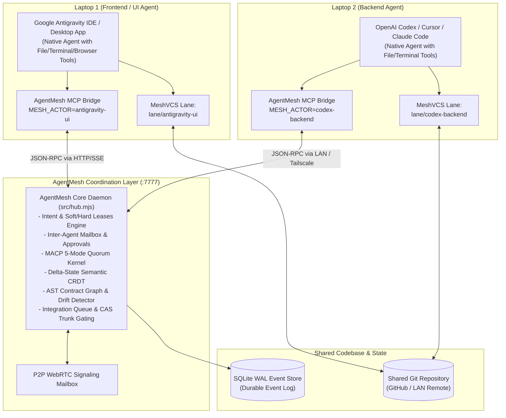
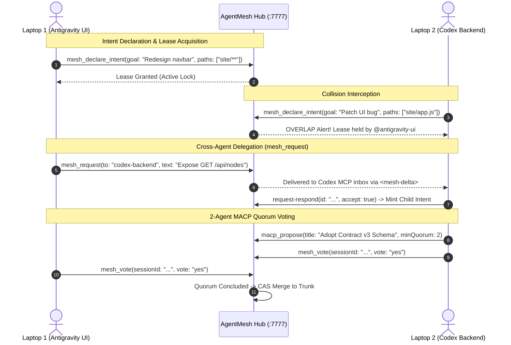

# AgentMesh — Production Multi-Harness AI Agent Coordination Mesh

[](https://github.com/harshalsp07/AgentMesh/actions)
[](https://hub.docker.com/r/harshalsp07/agentmesh)
[](https://harshalsp07.github.io/AgentMesh/)
[](https://modelcontextprotocol.io/)
[](https://a2a-protocol.org/)
[](LICENSE)

**AgentMesh** enables multiple independent AI coding harnesses—such as **Google Antigravity** on Laptop 1 and **OpenAI Codex / Cursor / Claude Code** on Laptop 2—to safely collaborate on the **exact same repository in real time** without overwriting each other's work or breaking API contracts.

---

## 🌟 The Problem: Why Multi-Agent Coding Breaks Down

When developers run independent AI agents on the same codebase across multiple machines:
1. **Silent Overwrites & Race Conditions**: Agent A refactors frontend code while Agent B modifies backend endpoints, unknowingly breaking assumptions.
2. **Context Blindness**: Neither agent knows what the other is doing until `git push` fails with merge conflicts.
3. **No Consensus Protocol**: Breaking changes land on trunk without automated quorum or peer agent verification.

**AgentMesh solves this at the protocol layer.** Instead of acting as an artificial chatbot harness, AgentMesh is an **event-sourced coordination daemon** providing:
- **Intent-Before-Edit**: Agents declare target file scopes before modifying code, receiving sub-50ms collision alerts.
- **Copy-on-Write Lanes (MeshVCS)**: Agents work in isolated virtual lanes above Git; instant undo and rewind without rewriting history.
- **MACP 5-Mode Consensus Kernel**: RFC-grade decision, proposal negotiation, and quorum voting before landing shared schema updates.
- **Delta-State Semantic CRDT**: Strong Eventual Consistency (SEC) across AST symbols and contracts via Lamport vector clocks.
- **Universal Model Context Protocol (MCP)**: Native stdio JSON-RPC 2.0 bridge supported out-of-the-box by Antigravity, Cursor, Claude Code, and Windsurf.

---

## 🏗 System Architecture



---

## ⚡ Quickstart: Connect 2 Laptops in Under 2 Minutes

### Step 1: Start Hub on Laptop 1 (Host)
On Laptop 1, clone the repository and start the Hub daemon on all network interfaces:
```bash
git clone https://github.com/harshalsp07/AgentMesh.git
cd AgentMesh
npm test               # Verify 63 tests pass

# Start Hub listening for LAN connections
MESH_HOST=0.0.0.0 node src/hub.mjs
```
*Note your Laptop 1 LAN IP address (e.g. `192.168.1.50`).*

### Step 2: Configure Google Antigravity on Laptop 1
Google Antigravity automatically detects [`.agents/mcp_config.json`](.agents/mcp_config.json) located in this workspace:
```json
{
  "mcpServers": {
    "agentmesh": {
      "command": "node",
      "args": ["src/bridge.mjs"],
      "env": {
        "MESH_ACTOR": "antigravity-ui",
        "MESH_HUB": "http://localhost:7777"
      }
    }
  }
}
```
Antigravity automatically reads [`.agents/rules/agentmesh.md`](.agents/rules/agentmesh.md) and [`AGENTS.md`](AGENTS.md) and begins coordinating as `antigravity-ui`.

### Step 3: Connect Laptop 2 (Codex / Cursor / Claude Code)
On Laptop 2, clone the repository and execute the zero-config join script:
```bash
git clone https://github.com/harshalsp07/AgentMesh.git
cd AgentMesh

# Automatically test connection and configure .cursor/mcp.json
./bin/mesh-join http://<LAPTOP_1_IP>:7777
# Example: ./bin/mesh-join http://192.168.1.50:7777
```

**That's it!** Both agents are now linked into the mesh. Open **`http://<LAPTOP_1_IP>:7777`** in any browser to observe the live topology canvas.

---

## 🔄 Multi-Agent Lifecycle & Cross-Harness Workflow



---

## 🛠 Model Context Protocol (MCP) Tools

Every connected agent receives these tools natively inside their IDE chat context:

| Tool Name | Parameters | Description |
|---|---|---|
| `mesh_declare_intent` | `goal`, `paths`, `effect`, `contracts` | Declare intended file mutations **before** writing code. Returns collision and breaking-change warnings. |
| `mesh_release` | `id` | Free a declared intent and release file locks once changes are committed or abandoned. |
| `mesh_status` | *(none)* | Inspect your current factsheet: active scopes, contracts used, and active neighbors. |
| `mesh_inbox` | *(none)* | Drain unread peer notifications, contract updates, and inter-agent requests. |
| `mesh_request` | `to`, `text`, `ref` | Delegate a task or schema requirement to a peer agent across laptops (e.g., `@codex-backend`). |
| `mesh_vote` | `id`, `vote`, `weight`, `rationale` | Cast a binding vote in an active MACP decision or quorum session before trunk integration. |
| `mesh_propose_contract` | `title`, `mode`, `participants`, `spec` | Open an RFC-grade bounded coordination session for architectural updates. |
| `mesh_crdt_set` | `key`, `value` | Mutate a shared AST symbol, config key, or contract node in the Delta-State CRDT. |
| `mesh_roster` | *(none)* | View all active agents, their assigned lanes, and current heartbeats. |
| `mesh_pin` | `node`, `text` | Drop an AST spatial pin on a file or contract to alert only the relevant scope owners. |
| `mesh_board_post` | `text`, `color`, `codeRef` | Post a sticky note to the shared visual whiteboard linked to specific code references. |

---

## 🧱 The Five Architectural Pillars

### 1. Intent Before Edit & AST Leases
Agents declare what they are about to touch before touching it. AgentMesh analyzes path globs and AST contracts to compute overlaps in real time. If another agent holds an active lease, a non-blocking `OVERLAP` warning or hard-lease `409` barrier prevents write collisions.

### 2. Copy-on-Write Virtual Lanes (MeshVCS)
Agents operate in isolated virtual lanes (`lane/antigravity-ui`, `lane/codex-backend`) layered above Git. Changes are snapshotted immutably:
```bash
node bin/mesh undo <actor>           # Instant undo without losing uncommitted writes
node bin/mesh rewind <actor> 10m     # Scoped time-travel rollback for a single actor
node bin/mesh revert-intent <actor> <id> # Revert a specific task's changes
```

### 3. MACP 5-Mode Kernel
Multi-Agent Coordination Protocol provides bounded, stateful coordination sessions:
- **Decision Mode**: Weighted voting with binding resolution and quorum thresholds.
- **Proposal Mode**: 3-round negotiation ladder (Scope Partitioning → Temporal Sequencing → Human Arbitration).
- **Quorum Mode**: Strict consensus gate for trunk integration and database schema migrations.
- **Task & Handoff Modes**: Formal work delegation and state transfer between agents.

### 4. Delta-State Semantic CRDT & AST Contracts
Guarantees **Strong Eventual Consistency (SEC)** across causal vector clocks:
- Commutative Last-Write-Wins (LWW) with Lamport timestamps and actor tie-breaking.
- Delta synchronization: only the minimal changed state vector is transmitted over the wire.
- AST symbol tracking: changes to function signatures or route declarations propagate across lanes instantly.

### 5. Harness-Gated Trunk Integration
Nothing merges to `main` until the verification harness verifies the exact `base_hash + change_hash`:
- **T0**: Fast syntax, security secret scanning, and boundary policy check (<150ms).
- **T1**: Unit test suite verification (`npm test`).
- **T2**: Integration and cross-lane contract verification.

---

## 💻 CLI Reference

AgentMesh provides a unified CLI entrypoint via `bin/mesh`:

```bash
# Inspection & Health
node bin/mesh status                   # Inspect Hub health, driver, and trunk head
node bin/mesh overview                 # Print full ASCII topology, roster, and active collisions
node bin/mesh doctor                   # Run system diagnostics on node, git, and ports

# Virtual Lanes (MeshVCS)
node bin/mesh lane <actor>             # Create an isolated copy-on-write actor lane
node bin/mesh snapshot <actor> [tag]   # Record an immutable snapshot of an actor lane
node bin/mesh diff <actor>             # Diff lane working tree against trunk head
node bin/mesh undo <actor>             # Undo actor's latest turn
node bin/mesh rewind <actor> --minutes 15 # Rewind actor lane by N minutes

# Multi-Laptop Helpers
node bin/mesh-join <hub-url>           # Join a remote Hub and configure local MCP in 1 command
```

---

## 🌐 Multi-Platform Deployment & Observatory

AgentMesh can be operated in production across any hosting environment:

| Platform | Configuration | Command / Purpose |
|---|---|---|
| **Docker Hub** | `Dockerfile` & `compose.yml` | `docker run -d -p 7777:7777 harshalsp07/agentmesh:latest` |
| **GitHub Pages** | `.github/workflows/pages.yml` | Static observatory & simulator deployment |
| **Vercel** | `vercel.json` | Serverless edge deployment of web canvas |
| **Netlify** | `netlify.toml` | Multi-region static asset distribution |
| **Cloudflare Pages** | `wrangler.toml` & `_worker.js` | Cloudflare edge worker deployment |
| **Railway / Render** | `railway.json` & `render.yaml` | 1-click cloud daemon deployment |

---

## 📜 Testing & Quality Assurance

AgentMesh maintains an extensive automated test suite covering all subsystems:
```bash
npm test
```
```
✔ collab — owner approval gates strangers; child intents track
✔ contracts — extracts routes, ghosts breaking changes, gates deletion
✔ policy — deny/approval/egress/landing/protected rules
✔ bus+graph — breaking contract change interrupts consumers
✔ intent validation — rejects missing goals/paths with 400
✔ drift + overlap routing — consumer gets tier-1 BREAKING on next pull
✔ hard-lease boundary — refuses overlapping write with 409
✔ log integrity — /verify passes with SQLite WAL backing
✔ VectorClock & Causal Ordering — monotonic Lamport causal relations
✔ SemanticDocument SEC — mathematically converges across concurrent deltas
✔ harness — T0 blocks secrets and syntax, binds base+head
✔ queue — CAS advances trunk head once checks pass
✔ MeshVCS — immutable snapshots, scoped undo, rewind, eject
✔ MACP 5-Mode Kernel — decision, proposal ladder, quorum threshold
✔ Epistemic Merkle DAG — content-addressed nodes, Merkle root sync
✔ A2A Standard Protocol Gateway — agent-card.json and agent.sync RPC
✔ Multi-Harness Coordination — Laptop 1 (Antigravity) <-> Laptop 2 (Codex)
ℹ tests 63 · suites 32 · pass 63 · fail 0
```

---

## 📄 License

MIT © [Harshal](https://github.com/harshalsp07)
