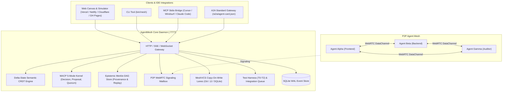
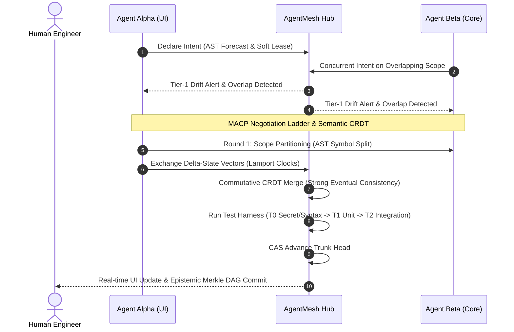
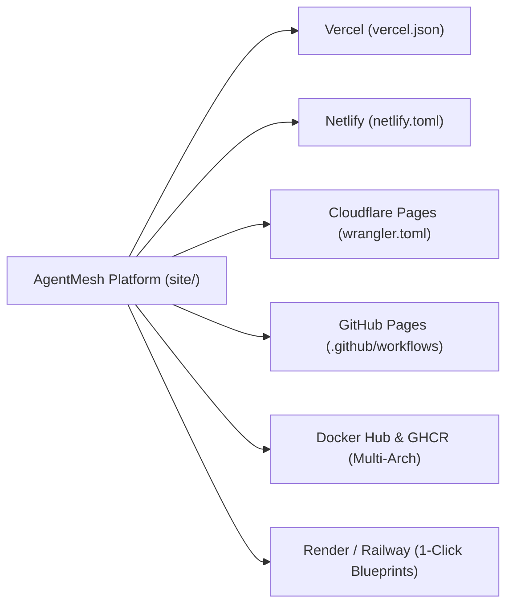

# AgentMesh v1.2.0 — Production-Ready Multi-Agent Platform & Publishing

One repo behaves like one shared system: one hub, copy-on-write lanes per actor,
MeshVCS above git, intent-before-edit, contracts as first-class nodes, harness-gated trunk,
plus **Delta-State Semantic CRDT**, **MACP 5-Mode Kernel**, **Epistemic Merkle DAG**,
and **Universal Multi-Platform Publishing** (Vercel, Netlify, Cloudflare, GitHub Pages, Docker, Railway, Render).

## Run it

```bash
npm test             # 59 tests green (incl. vcs backends, CRDT, MACP, DAG, publishing)
npm run publish:check # verifies all 18 platform deployment configurations
npm run demo:all     # all 6 demo scenarios verified
node src/hub.mjs     # hub on :7777 — modern canvas http://localhost:7777/
node src/mesh.mjs status --root .mesh
node scripts/doctor.mjs
```

## Architecture & System Design



## Next-Gen Multi-Agent Synchronization Lifecycle



## Universal Deployment Matrix




## Collaborating (the best parts)

- **Roster + availability:** `mesh roster join <name> --role human|agent --skills a,b --owner <human>`; `mesh roster avail <name> focus|dnd|available`. Focus/DND never get toasts — digests only.
- **Ask agents:** `mesh request create <agent> "please expose createdAt" --from me` → owner approval inbox (`mesh request` lists); trusted teammates skip it. `accept` mints a child intent; chips track queued→working→done/declined. Agents use MCP `mesh_request`.
- **Spatial pins:** `mesh pin add src/api/auth/login.ts "race here?"` routes to scope owners only. Agents use MCP `mesh_pin`.
- **Decisions:** `mesh decide record "auth rename" "keep /api/auth until UI migrates"` — one-line record per change; the Referee writes these; canvas shows the latest 5.
- **Stay in flow:** 10-min 5-line `mesh digest`, `mesh standup <me> --doing/--done/--blocked`, WIP limit 2 (`mesh wip <actor> <n>`), quiet hours (`mesh quiet <human> 22 7`), toast cap 3/10min with digest batching.
- **Handoffs:** `mesh capsule export --from me --intent "auth v2"` → `mesh capsule import <id>` — finish in one tool, continue in another (read-only brief).
- **Pairing:** `mesh pair start <a> <b>` opens a scratch lane; `mesh pair <a> <b> <topic>` runs the negotiation ladder (2 rounds, then human).
- **Health:** `mesh health --tp 9 --fp 1` — precision ≥0.9 keeps warnings trusted, else advisory; `mesh brief` onboards newcomers in ~30 lines.

## Map: design doc → code

| Design section | Code |
|---|---|
| Mesh Core daemon | `src/hub.mjs` (log, presence, intents, leases, router, sheets, SSE) + `src/store.mjs` |
| Micro-VM sandbox | `src/drivers.mjs` (detect/boot Lite/Container/Lima-WSL2/Firecracker), `src/mesh.mjs run` (L4 wrap), dep steward |
| MeshVCS | `src/lanes.mjs` (snapshot/diff/rebase/undo/rewind/revert-intent/freeze/checkpoint/eject) |
| Intents, leases, queue | hub (forecast + soft/hard leases) + `src/queue.mjs` (propose/approve/drain, CAS, bisect, dial) |
| Contracts + drift | `src/contracts.mjs` + `src/graph.mjs` (extract/diff/ghost/gate/x-verify) |
| Harness | `src/harness.mjs` (T0/T1/T2/T3, verdicts bound to base+head, flake→flaky) + `.mesh/policy.yaml` + `src/policy.mjs` |
| Integrations | `src/bridge.mjs` (MCP stdio), `src/mesh.mjs hook` (L3), `extension/` (VS Code/Cursor/Windsurf thin client) |
| Semantic bus | `src/bus.mjs` (say+facts+refs, tiers 1–3, hop-3, dedupe, 20/min breaker, requests, sheet compiler) |
| Canvas | `src/canvas.html` served at `GET /canvas`, live from `/state` + `/events` |
| Schemas | envelope/intent/lease/contract/changeset/verdict/operation shapes in `src/store.mjs` + hub |
| Failure modes | each row has an implementation + demo/test: undo, rebase objects, ghost+gate, budgets, breaker, TTL, WAL-reload, bundles, epoch fence, eject |
| Security | shims+deny list+allowlist (`policy.mjs`), secret scan+redact (`store.mjs`), provenance in ops log (`mesh audit`) → production: ed25519 capabilities (`src/auth.mjs`), enforced hub auth, real PATH shims (`src/shims.mjs`), `/metrics`+`/ready`, runbooks in `docs/` |
| Zero-to-running | `bash install.sh` / `mesh up`, `doctor`, canvas invite view; production: `bin/mesh`, Dockerfile+healthcheck, compose (hub+standby), CI |
| VCS backends | `src/vcs.mjs` router: git objects (`gitvcs.mjs`), Jujutsu opt-in (`jjvcs.mjs`), zero-binary SQLite store (`sqlitevcs.mjs`); real `git merge-file` (`merge.mjs`) |
| PoC + bold ideas | `demo.mjs` (drift), `demo-phase1/2/3.mjs`, ghost + rewind-one-agent + live-wire edges + referee hooks + demo-ready trunk tag via queue |

## MCP wiring (any client)

```json
{ "mcpServers": { "agentmesh": {
  "command": "node", "args": ["/home/harshal/Project/src/bridge.mjs"],
  "env": { "MESH_ACTOR": "ui-agent", "MESH_HUB": "http://localhost:7777" } } } }
```

Rules: declare intent before multi-file edits; `mesh_status` per task; read `<mesh-delta>` first; `[tier 1]` = blocking.

## Sharing: whiteboard + voice

- **Board** (canvas Board tab): notes, text, rects, ellipses, arrows, pen, eraser, colors, drag-to-move. Every stroke is an op — synced live, persisted, replayable. Stickies take a code ref (`⌁`) linking board↔code. `mesh board` shows the count; export downloads tldraw-compatible JSON, import takes it back.
- **Voice** (canvas Voice tab): one click joins P2P audio. The hub only passes SDP/ICE envelopes (60 s mailbox, never logged); media goes browser-to-browser — fine for a 3–5 person room, no server media bill. Speaking rings, mute, listen-only without a mic.
- **Agents welcome:** MCP `mesh_board_post` drops a proposal sticky the whole room sees.
